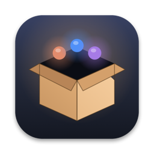
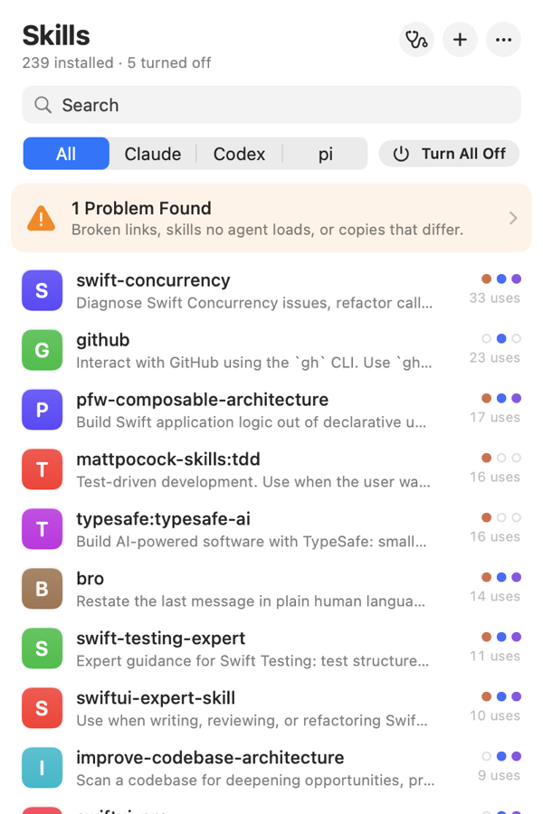
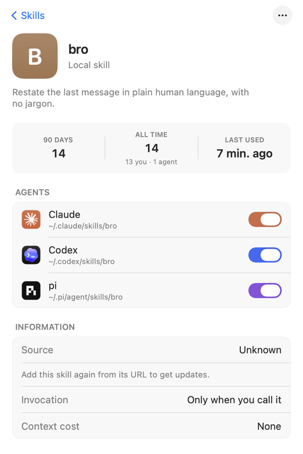
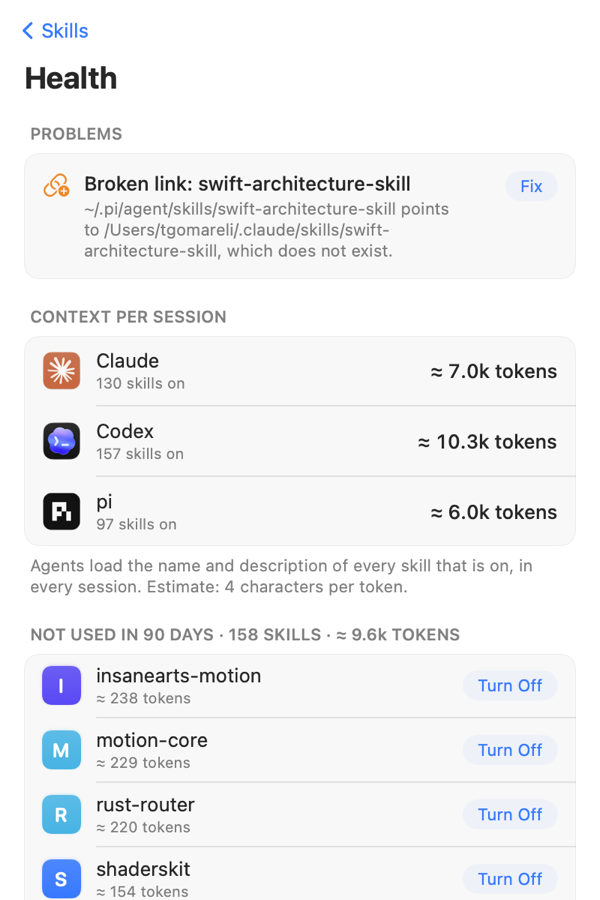

<p align="center">
  
</p>
<h1 align="center">SkillsPack</h1>
<h3 align="center">Every agent skill on your Mac, in one menu bar.</h3>

<p align="center">
  
  
  
  
</p>

<p align="center">
  
</p>

Claude Code, Codex and pi each keep their own skills in their own folders, with their own way to
turn one off. SkillsPack reads all of them and shows them in one list which agents have each
skill, whether it is on, and how often you and your agents used it.

## See every skill

The list shows each skill with three dots, one per agent: filled when it is on, a ring when it is
off, faint when that agent does not have it. Skills are ranked by how often they were used in the
last 90 days, counted from the agents' session logs, split into uses by you and uses by the agent.
Search, filter by agent, or show only skills that are off, never used, or have an update.

Open a skill to read its `SKILL.md`, see where each agent keeps it, and turn it on or off with a
switch per agent.

<p align="center">
  
  
  
</p>

## Fix what is broken

Health finds broken symlinks, skills sitting in a folder no agent reads (such as `~/.pi/skills`)
and copies of one skill that differ between agents, and fixes each with one click.

It also shows what your skills cost: every agent loads the name and description of each skill
that is on, in every session. SkillsPack estimates the tokens per agent and lists the skills you
have not used in 90 days, with a button to turn them off.

## Add skills from a URL

Paste `owner/repo`, a GitHub link to a repository or to one skill's folder, or any git URL.
SkillsPack clones it, lists the skills inside, and copies the ones you pick into each agent's
folder. It records where each skill came from, so **Check Skills for Updates** can compare your
copy with the source. Skills installed with `npx skills` keep their source too, and skills from
Claude plugins update through `claude plugin update`.

## Install

With Homebrew:

```sh
brew install --cask tornikegomareli/tap/skillspack
```

Or with one line, which downloads the latest notarized release, checks it with Gatekeeper and
copies it to /Applications:

```sh
curl -fsSL https://raw.githubusercontent.com/InsaneArts/SkillsPack/main/install.sh | bash
```

Or grab [**SkillsPack.dmg**](https://github.com/InsaneArts/SkillsPack/releases/latest/download/SkillsPack.dmg)
from the latest release.

## Build

```sh
git clone https://github.com/InsaneArts/SkillsPack.git
cd SkillsPack
swift build
swift test
Scripts/run.sh       # package build/SkillsPack.app and open it
```

## License

[MIT](LICENSE)
